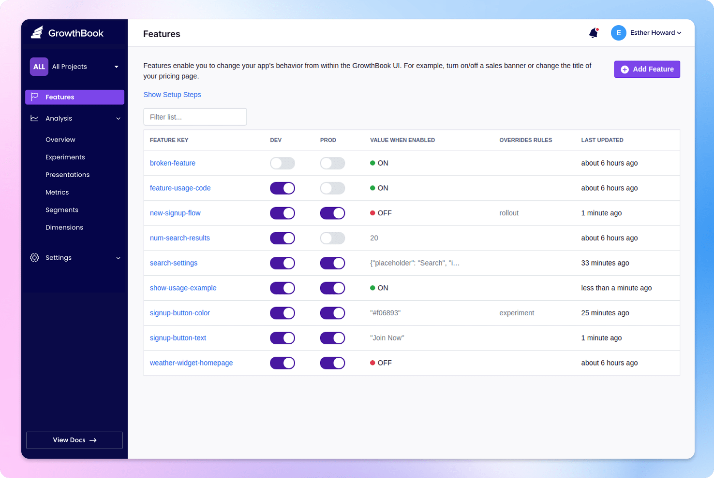

<p align="center"><b style="font-size:32px">验环 TestRing</b></p>
<p align="center"><b>开源特性开关与 A/B 实验平台（私有化部署）</b></p>
<p align="center">基于 GrowthBook 开源版（MIT）剥离企业商业模块后重制<br/>原项目：https://github.com/growthbook/growthbook</p>

> **许可说明**：本仓库主体为 MIT 许可（见 LICENSE，保留原作者版权声明）；
> 上游 `packages/*/src/enterprise` 等商业许可目录已彻底删除，`packages/*/enterprise`
> 下的兼容桩为验环团队自研代码（MIT）。Modified by 验环团队。

## 快速开始（Docker Compose 一键私有化部署）

```sh
git clone <本仓库地址>
cd testring
docker compose up -d
```

然后访问 http://localhost:3000。数据库默认走 PostgreSQL + FerretDB（Mongo 协议兼容），
自遥测默认关闭（`DISABLE_TELEMETRY=1`），数据不出内网。

---

This pulls our prebuilt public Docker image and needs no registry credentials. If you instead build the image from the `Dockerfile` in this repo, its hardened base images come from Docker's `dhi.io` registry, which requires a one-time `docker login dhi.io` with any free Docker account — see [Building from source](https://docs.testring.dev/self-host#building-from-source).

[](https://www.testring.dev)

## Our Philosophy

The top 1% of companies spend thousands of hours building their own in-house experimentation, feature flagging, and analytics platforms.
The other 99% are left paying for expensive 3rd party SaaS tools or hacking together unmaintained open source libraries.

We want to give all companies the flexibility and power of a fully-featured in-house platform without needing to build it themselves.

## Major Features

- 🏁 Feature flags with advanced targeting, gradual rollouts, and experiments
- 💻 24 SDKs including [React](https://docs.testring.dev/lib/react), [Python](https://docs.testring.dev/lib/python), [Android](https://docs.testring.dev/lib/kotlin), and [iOS](https://docs.testring.dev/lib/swift). [View all](https://docs.testring.dev/lib)
- 🆎 World class experiment stats engine (CUPED, Sequential, Bayesian, Post-Strat, Bandits, SRM checks).
- ❄️ Warehouse Native. Query 11 data sources including BigQuery, Snowflake, and Databricks. [View all](https://docs.testring.dev/app/datasources).
- 🎯 Flexible SQL-backed metric definitions. Simple conversion rates, ratios, quantiles, and more.
- 📊 Built-in Product Analytics suite to build dashboards and share with your team.
- 📝 Document everything with screenshots, custom meta fields, and Markdown throughout.
- 🔔 Webhooks and a full REST API for building integrations and custom workflows.
- 🤖 MCP server to create features, start experiments, clean up stale flags, and more.

## Documentation and Support

View the [TestRing Docs](https://docs.testring.dev) for info on how to configure and use the platform.

Join [our Slack community](https://slack.testring.dev?ref=readme-support) if you get stuck, want to chat, or are thinking of a new feature.

Or email us at [hello@testring.dev](mailto:hello@testring.dev) if Slack isn't your thing.

We're here to help - and to make TestRing even better!

## Contributors

We ❤️ all contributions, big and small!

Read [CONTRIBUTING.md](/CONTRIBUTING.md) for how to set up your local development environment.

If you want to, you can reach out via [Slack](https://slack.testring.dev?ref=readme-contributing) or [email](mailto:hello@testring.dev) and we'll set up a pair programming session to get you started.

## License

TestRing is an Open Core product. The bulk of the code is under the permissive MIT license. There are several directories that are governed under a separate commercial license, the TestRing Enterprise License.

View the `LICENSE` file in this repository for the full text and details.


